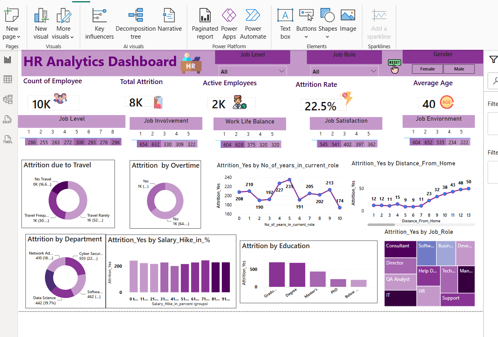

# 📊 HR Attrition Analytics Dashboard

> **An end-to-end HR Analytics project focused on identifying employee attrition drivers and enabling data-driven retention strategies using Power BI.**

---





## 📌 Project Overview

Employee attrition is one of the most expensive challenges organizations face. High employee turnover leads to increased hiring costs, productivity loss, knowledge drain, and project delays.

This project analyzes HR employee data to uncover the key factors influencing attrition and presents actionable insights through an interactive dashboard for HR leaders and business stakeholders.

---

## 🎯 Business Problem

A service-based IT company with approximately **10,000 employees** was experiencing an employee attrition rate of **22.47%**. HR teams lacked clear visibility into:

* Which departments have the highest attrition
* Which job roles are at greatest risk
* Whether overtime contributes to resignations
* The impact of work-life balance and job satisfaction
* Whether salary hikes improve employee retention
* The relationship between business travel and employee turnover

The objective was to convert raw HR data into meaningful business insights that support strategic retention decisions.

---

# 🛠️ Technology Stack

* Power BI
* Power Query
* DAX
* Microsoft Excel
* Data Visualization
* HR Analytics
* Business Intelligence

---

# 📈 Dashboard Objectives

The dashboard was designed to help HR teams answer critical business questions, including:

✔ Overall Employee Attrition Rate

✔ Attrition by Department

✔ Attrition by Job Role

✔ Overtime vs Attrition

✔ Business Travel Impact

✔ Job Satisfaction Analysis

✔ Work-Life Balance Analysis

✔ Salary Hike Impact

✔ Years at Company vs Attrition

✔ Employee Demographics

---

# 📊 Business KPIs

The dashboard focuses on business metrics such as:

* Employee Attrition Rate
* Total Employees
* Active Employees
* Attrition Count
* Department-wise Attrition
* Job Role Analysis
* Overtime Analysis
* Work-Life Balance
* Job Satisfaction
* Salary Hike Trends

---

# 💡 Business Insights

This project enables HR leadership to:

* Identify departments with high employee turnover
* Detect high-risk employee groups
* Understand key attrition drivers
* Improve workforce planning
* Build targeted retention strategies
* Support evidence-based HR decisions

---

# 👥 Stakeholders

* HR Department
* Department Heads
* Team Leads
* Recruitment Team
* Finance Team
* Business Leadership

Each stakeholder can use the dashboard to make informed decisions related to employee retention, workforce planning, and operational efficiency.

---

# 🚀 Business Impact

This dashboard supports organizations by:

* Reducing employee turnover
* Improving employee retention
* Lowering recruitment costs
* Enhancing workforce planning
* Increasing project stability
* Enabling data-driven HR decisions

---

# 📷 Dashboard Preview

> *(Add your Power BI dashboard screenshots here.)*

Example:

```
images/dashboard_overview.png
images/department_analysis.png
images/employee_insights.png
```

---

# 📂 Repository Structure

```
HR-Attrition-Analytics/
│
├── Dataset/
├── Power BI Dashboard/
├── SQL/
├── Images/
├── Documentation/
├── README.md
```

---

# 📚 Key Skills Demonstrated

* Business Problem Solving
* Data Cleaning
* Data Transformation
* Exploratory Data Analysis
* KPI Development
* Dashboard Design
* Business Intelligence
* Data Storytelling
* Stakeholder Communication
* Analytical Thinking

---

# 🔍 Future Enhancements

Potential next steps for this project include:

* Predictive Attrition Modeling
* Employee Attrition Risk Score
* Real-Time Dashboard Refresh
* Department Benchmarking
* Forecasting Attrition Trends
* Automated Executive Reports

---

# ⭐ About This Project

This project demonstrates my ability to transform business requirements into actionable analytics solutions. Rather than focusing only on dashboard creation, the emphasis is on understanding business challenges, analyzing HR data, and presenting insights that help decision-makers improve employee retention and organizational performance.

---

## 👨‍💻 Author

Vicky Jeeru

**Aspiring Data Analyst | Power BI | SQL | Excel | 

If you found this project useful, consider ⭐ starring the repository.
